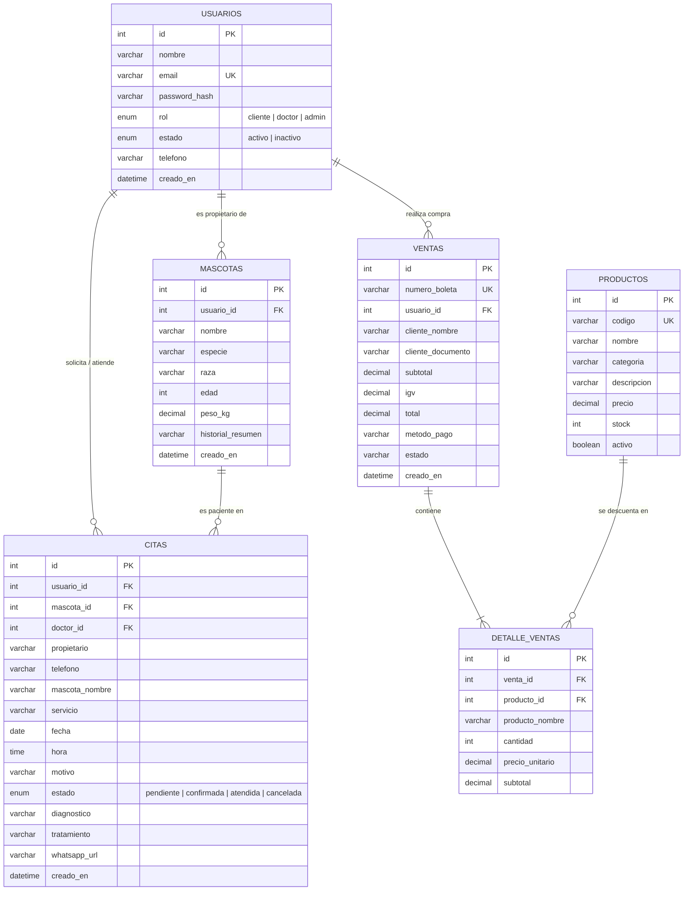

# Documentación de Arquitectura, Diagramas UML (GoF), DER y Guía de Sustentación

## 1. Resumen de Capas y Tecnologías Implementadas

| Módulo / Capa | Tecnologías | Aplicación exacta en Clínica Veterinaria Patitas Felices |
| :--- | :--- | :--- |
| **1. Frontend** | Astro 7, HTML5, CSS3 (Bootstrap 5), JS (`fetch`) | Responsive Design (Mobile-first). Vistas por rol: Landing/Tienda (`/tienda` - Cliente), Agenda/Historial (`/doctor` - Doctor) y CRM/Dashboard (`/admin` - Admin) + Login RBAC (`/login`). |
| **2. Backend** | Python 3 (FastAPI + Pydantic + Uvicorn) | API RESTful (`backend/main.py`) conectada a los formularios de Astro mediante `fetch()`. Contiene la lógica de negocio y los **4 patrones de diseño GoF**. |
| **3. Database** | Supabase (PostgreSQL) / MySQL / SQLite | 6 tablas clave: `usuarios` (con `rol` y `estado` activo/inactivo), `mascotas`, `citas`, `productos`, `ventas`, `detalle_ventas`. |
| **4. Docs** | Markdown, Mermaid, Draw.io (`.drawio`), Swagger | Diagramas UML de clases (mostrando los 4 patrones GoF), Diagrama Entidad-Relación (DER) y manual de configuración rápida + Swagger UI en `http://127.0.0.1:8000/docs`. |
| **5. Test** | Pytest, Node Test, Playwright, Postman | Pruebas unitarias en Python (`backend/tests/test_patterns_and_api.py`) para validar cálculo de boletas, permisos RBAC, Proxy y Adapter, y colección Postman (`postman/Patitas_Felices_API.postman_collection.json`). |

---

## 2. Diagrama UML de Clases (Los 4 Patrones de Diseño GoF en Python)

```mermaid
classDiagram
    %% =========================================================
    %% 1. PATRÓN PROXY (Seguridad JWT y Sesión Activa)
    %% =========================================================
    class ISecureController {
        <<interface>>
        +ejecutar_accion(token: str, accion: str, parametros: dict) dict
    }

    class AuthSessionProxy {
        -RealClinicController _real_controller
        -IDatabaseAdapter _db
        +validar_sesion(token: str) dict
        +ejecutar_accion(token: str, accion: str, parametros: dict) dict
    }

    class RealClinicController {
        -IDatabaseAdapter db
        +ejecutar_accion(token: str, accion: str, parametros: dict) dict
    }

    ISecureController <|.. AuthSessionProxy
    ISecureController <|.. RealClinicController
    AuthSessionProxy --> RealClinicController : delega si JWT y estado=='activo'
    AuthSessionProxy --> RBACContext : verifica permisos RBAC

    %% =========================================================
    %% 2. PATRÓN STRATEGY + RBAC (Autorización por Stakeholder)
    %% =========================================================
    class RoleAuthorizationStrategy {
        <<interface>>
        +nombre_rol() str
        +permisos_permitidos() set
        +tiene_permiso(accion: str) bool
        +obtener_configuracion_vista() dict
    }

    class ClientRoleStrategy {
        +tiene_permiso(accion: str) bool
        +obtener_configuracion_vista() dict
    }

    class DoctorRoleStrategy {
        +tiene_permiso(accion: str) bool
        +obtener_configuracion_vista() dict
    }

    class AdminRoleStrategy {
        +tiene_permiso(accion: str) bool
        +obtener_configuracion_vista() dict
    }

    class RBACContext {
        -RoleAuthorizationStrategy _strategy
        +cambiar_estrategia(nueva: RoleAuthorizationStrategy)
        +autorizar(accion: str) bool
        +obtener_vista_y_permisos() dict
    }

    RoleAuthorizationStrategy <|.. ClientRoleStrategy
    RoleAuthorizationStrategy <|.. DoctorRoleStrategy
    RoleAuthorizationStrategy <|.. AdminRoleStrategy
    RBACContext o-- RoleAuthorizationStrategy : cambia dinámicamente

    %% =========================================================
    %% 3. PATRÓN ADAPTER (BD Supabase/MySQL y WhatsApp API)
    %% =========================================================
    class IDatabaseAdapter {
        <<interface>>
        +obtener_usuario_por_email(email: str) dict
        +obtener_usuario_por_id(id: int) dict
        +listar_productos(solo_activos: bool) list
        +descontar_stock_producto(id: int, cant: int) bool
        +registrar_venta_y_detalles(cabecera: dict, detalles: list) dict
    }

    class SQLiteDatabaseAdapter {
        +inicializar_esquema()
    }
    class SupabasePostgresAdapter {
        +String supabase_url
    }
    class MySQLDatabaseAdapter {
        +String host
    }

    IDatabaseAdapter <|.. SQLiteDatabaseAdapter
    SQLiteDatabaseAdapter <|-- SupabasePostgresAdapter
    SQLiteDatabaseAdapter <|-- MySQLDatabaseAdapter

    class IWhatsAppNotificationAdapter {
        <<interface>>
        +generar_enlace_cita(datos_cita: dict) str
        +generar_enlace_boleta(numero_boleta: str, cliente: str, total: float) str
    }

    class WhatsAppAdapter {
        +String numero_clinica
        +generar_enlace_cita(datos_cita: dict) str
        +generar_enlace_boleta(numero_boleta: str, cliente: str, total: float) str
    }

    IWhatsAppNotificationAdapter <|.. WhatsAppAdapter

    %% =========================================================
    %% 4. PATRÓN FACADE (Checkout y Boleta PDF en Memoria)
    %% =========================================================
    class TiendaFacade {
        -SubsistemaInventario inventario
        -SubsistemaCRMTransacciones crm
        -SubsistemaGeneradorPDF pdf_generator
        -IWhatsAppNotificationAdapter whatsapp
        +procesar_venta(usuario_id: int, cliente_nombre: str, cliente_documento: str, items: list, metodo_pago: str) dict
    }

    class SubsistemaInventario {
        +validar_y_preparar_items(items: list) list
        +descontar_stock(items: list) void
    }

    class SubsistemaCRMTransacciones {
        +calcular_totales_boleta(items: list) dict
        +registrar_transaccion(...) dict
    }

    class SubsistemaGeneradorPDF {
        +construir_pdf_en_memoria(venta: dict) bytes
    }

    TiendaFacade *-- SubsistemaInventario : 1. Descuenta stock
    TiendaFacade *-- SubsistemaCRMTransacciones : 2. Registra en CRM
    TiendaFacade *-- SubsistemaGeneradorPDF : 3. Crea PDF en memoria
    TiendaFacade --> IWhatsAppNotificationAdapter : 4. Enlace constancia
    SubsistemaInventario --> IDatabaseAdapter
    SubsistemaCRMTransacciones --> IDatabaseAdapter
```



---

## 3. Diagrama Entidad-Relación (DER - 6 Tablas Clave)



---

## 4. Cómo Sustentar tus 4 Patrones en Python frente al Profesor

### 1. Patrón Proxy (`backend/patterns/proxy.py` — Puntos 1 y 4)
* **¿Qué problema resuelve?** Evita que los endpoints de FastAPI accedan directamente a `RealClinicController` sin antes verificar la validez de la sesión y el estado administrativo del usuario.
* **¿Cómo funciona en tu código?**
  1. `AuthSessionProxy` y `RealClinicController` implementan la misma interfaz `ISecureController`.
  2. Cuando Astro envía una petición con `Authorization: Bearer <token>`, `AuthSessionProxy.validar_sesion()` verifica la firma criptográfica HMAC-SHA256 y la fecha de expiración del JWT.
  3. **Punto clave para el jurado:** Aunque el usuario tenga un JWT válido emitido hace 5 minutos, el Proxy consulta en vivo la tabla `usuarios`. Si el Administrador cambió su `estado` a `'inactivo'` en `/admin`, el Proxy lanza `ErrorSeguridadProxy (HTTP 403)` inmediatamente sin llegar al controlador real.

### 2. Patrón Strategy + RBAC (`backend/patterns/strategy.py` — Puntos 1, 5 y 6)
* **¿Qué problema resuelve?** Elimina los bloques condicionales `if rol == 'admin' elif rol == 'doctor'...` dispersos por todo el sistema.
* **¿Cómo funciona en tu código?**
  1. La interfaz `RoleAuthorizationStrategy` define el contrato `tiene_permiso(accion)` y `obtener_configuracion_vista()`.
  2. Existen 3 estrategias concretas encapsuladas:
     * `ClientRoleStrategy`: Autoriza `comprar_productos`, `agendar_cita`, `ver_mis_citas` y devuelve la vista `/tienda`.
     * `DoctorRoleStrategy`: Autoriza `ver_agenda_doctor`, `actualizar_diagnostico` y devuelve la vista `/doctor`.
     * `AdminRoleStrategy`: Autoriza `ver_crm_dashboard`, `cambiar_estado_usuario` y devuelve la vista `/admin`.
  3. `RBACContext` intercambia la estrategia en tiempo de ejecución según quién inicia sesión.

### 3. Patrón Adapter (`backend/patterns/adapter.py` — Puntos 1, 3 y 6)
* **¿Qué problema resuelve?** Desacopla la lógica de negocio de la clínica respecto a motores de bases de datos externos (Supabase PostgreSQL / MySQL) y del formato de URL de la API de WhatsApp.
* **¿Cómo funciona en tu código?**
  1. `WhatsAppAdapter` implementa `IWhatsAppNotificationAdapter` y transforma diccionarios de citas o boletas en URLs codificadas `https://wa.me/51990853697?text=...`.
  2. `IDatabaseAdapter` define las operaciones sobre las 6 tablas, permitiendo alternar entre `SQLiteDatabaseAdapter`, `SupabasePostgresAdapter` y `MySQLDatabaseAdapter` mediante la variable de entorno `DB_ENGINE` sin tocar una sola línea de `TiendaFacade` ni de `RealClinicController`.

### 4. Patrón Facade (`backend/patterns/facade.py` — Puntos 1 y 7)
* **¿Qué problema resuelve?** El checkout de una compra veterinaria involucra múltiples subsistemas complejos (control de stock, cálculo tributario de IGV para el CRM y generación binaria de un documento PDF).
* **¿Cómo funciona en tu código?**
  1. El Frontend Astro solo hace una llamada: `POST /api/tienda/checkout`, que invoca `TiendaFacade.procesar_venta()`.
  2. Internamente, `TiendaFacade` coordina en orden:
     * `SubsistemaInventario`: Verifica que haya stock suficiente y ejecuta `UPDATE productos SET stock = stock - ?`.
     * `SubsistemaCRMTransacciones`: Calcula Op. Gravada (`Subtotal = Total / 1.18`), `IGV (18%)` y `Total`, e inserta en `ventas` y `detalle_ventas` con numeración `B001-XXXXXX`.
     * `SubsistemaGeneradorPDF`: Construye en memoria un archivo `%PDF-1.4` real en bytes/Base64 listo para descargar e imprimir.

---

## 5. Manual de Configuración Rápida y Ejecución

### Paso 1: Levantar el Backend Python (FastAPI)
```powershell
python -m uvicorn backend.main:app --host 127.0.0.1 --port 8000 --reload
```
* Documentación interactiva **Swagger UI**: `http://127.0.0.1:8000/docs`
* Estado de salud y patrones: `http://127.0.0.1:8000/api/health`

### Paso 2: Levantar el Frontend (Astro)
```powershell
npm.cmd run dev
```
* Landing Page: `http://127.0.0.1:4321/`
* Login y selector de roles RBAC: `http://127.0.0.1:4321/login`
* Vista Cliente (Tienda + Boleta PDF Facade): `http://127.0.0.1:4321/tienda`
* Vista Doctor (Agenda e Historial Clínico): `http://127.0.0.1:4321/doctor`
* Vista Admin (CRM y Dashboard + Control de estado de usuarios): `http://127.0.0.1:4321/admin`

### Paso 3: Ejecutar las Pruebas Automatizadas
```powershell
# Pruebas unitarias en Python (Facade Boletas, Strategy RBAC, Proxy JWT y Adapter)
python -m pytest backend/tests/test_patterns_and_api.py -v

# Pruebas unitarias y verificación estructural de Astro
npm.cmd test
npm.cmd run build
npm.cmd run check:build
```
